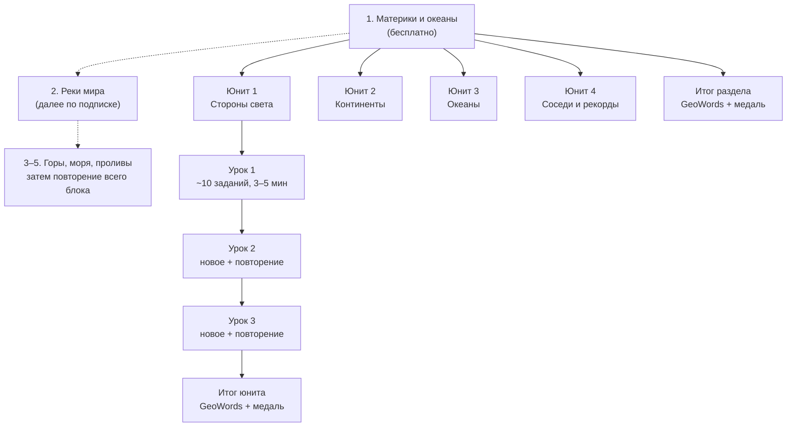

# GeoWords: механика приложения

20.10.2026 · Светлана Андреянова

> Живая версия документа: [GeoWords: механика приложения](https://claude.ai/artifact/2n6DuXwUAViGHjcyLA4Sbb). Этот файл — её копия в репозитории.

## Суть и аудитория

GeoWords — короткие ежедневные уроки географии на авторских картах: 3–5 минут в день, от материков и океанов до стран, рек и гор. Механика как у Duolingo: путь из уроков, интервальное повторение, серии дней. Содержание — от педагога-географа, в стиле печатных GeoWords.

- **Аудитория:** дети от 7 лет и взрослые. Содержание одно, подача разная (детский и взрослый режимы).
- **Языки:** английский и русский, переключение в настройках.
- **Деньги:** бесплатно + подписка.
- **Главный принцип:** единица знания — географический объект (материк, океан, река, столица). Все упражнения строятся из данных об объектах, а не пишутся вручную.
- **Отличие от конкурентов (Seterra, Duolingo):** авторские карты, проверенные факты и связь с печатными рабочими тетрадями GeoWords.

## Структура

Путь делится на разделы (темы), разделы — на юниты из 5–8 объектов, юниты — на уроки. Каждый юнит и каждый раздел заканчивается заданием GeoWords.



Тот, кто уже знает тему, может сразу пройти итог юнита и перескочить его.

Первый блок — мир: континенты и океаны, реки, горы, моря, проливы и заливы, затем повторение всего блока. Первый раздел бесплатный. Для блока нужна карта мира в том же стиле; утверждённые карты Европы — для следующего блока.

## Типы упражнений

Десять типов от лёгкого к трудному. Все строятся из одной карты и данных об объектах, примеры — на материках и океанах.

| Сложность | Тип | Что делает ученик | Пример |
| --- | --- | --- | --- |
| 0 | Знакомство | Смотрит на подсвеченный объект, читает название и один факт | «Это Африка. Через неё проходит экватор» |
| 1 | Найди на карте | Нажимает на нужный объект | «Нажми на Африку» |
| 1 | Что это? | Объект подсвечен, выбирает название из 3–4 | «Какой это океан?» |
| 2 | Подпиши карту | Перетаскивает подписи на объекты | 4 подписи на 4 океана |
| 2 | Правда или нет | Оценивает утверждение | «Австралия — самый маленький материк» |
| 3 | Пары | Соединяет объект с фактом | материк ↔ его рекорд |
| 3 | Выбери все | Нажимает на все подходящие объекты | «Нажми на все океаны, которые омывают Африку» |
| 4 | Напиши название | Собирает название из букв-плиток (дети) или печатает (взрослые) | подсвечена Антарктида → АНТАРКТИДА |
| 4 | GeoWords | По подсказкам находит буквы на карте и собирает слово | текущий прототип GRANITE |
| 5 | Без подсказок | Пустая карта: назвать все объекты по очереди | все материки и океаны за один раз |

Тип 0 — всегда первая встреча с объектом. GeoWords — итог юнита: в нём собрано всё, что ученик уже знает.

**Правила слова GeoWords**

1. Слово трудное: редкое, но настоящее и связанное с темой, чтобы его не угадали по первым буквам. Определение после разгадки учит новому слову.
2. Буквы открываются не по порядку: например, сначала седьмая, потом первая. Первая буква слова открывается ближе к концу; окончания (-TION, -ИЯ) и соседние буквы подряд не открываются в начале.
3. Порядок проверяется автоматически: после каждой открытой буквы считается, сколько слов словаря ещё подходят. Хороший порядок держит несколько вариантов как можно дольше.
4. Порядок букв выбирает приложение по этому правилу; Светлана видит его при утверждении задания и может поменять.

**Спорные факты**

1. У факта может быть метка «спорный» и оговорка на двух языках (как сноски в тетрадях).
2. На карточке рядом со спорным фактом — значок «Есть нюанс»; нажатие открывает окошко с оговоркой. Можно подать через Пипа: «А вот учёные спорят…».
3. Спорный факт не используется в заданиях с единственным ответом («Правда или нет», «Пары»). Если вопрос всё же задаётся, засчитываются оба ответа и показывается пояснение.
4. Известные спорные места: самая длинная река (Нил или Амазонка); самый солёный океан (Атлантический — по средней солёности); Австралия — остров или континент; 4 или 5 океанов; 6 или 7 материков; граница Европы и Азии (Эльбрус или Монблан — высочайшая вершина Европы); Каспий — море или озеро.

## Урок и повторение

Урок — около 10 заданий и 3–5 минут. В нём 2–3 новых объекта, остальное — повторение пройденного.

**Ход урока**

1. Знакомство с новыми объектами (тип 0).
2. Лёгкие задания на новое (типы 1–2).
3. Повторение старого, перемешанное с новым (типы 1–4 по уровню знания).
4. Ошибки урока возвращаются в конце, пока не будут решены верно.
5. Итог: XP, серия, на карте мира «раскрашивается» изученное.

**Ошибки.** Правильный ответ показывается сразу на карте, с коротким фактом. Ошибка не наказывается, а ставит объект в очередь на повторение.

**Интервальное повторение.** У каждого объекта три навыка, и каждый считается отдельно:

- **найти** (нажать на карте);
- **узнать** (выбрать название);
- **назвать** (написать без вариантов).

Верный ответ отодвигает следующее повторение навыка (примерно 1 → 3 → 7 → 16 → 35 дней), ошибка возвращает к интервалу в 1 день. Отдельная кнопка «Повторить» собирает урок из самых слабых объектов.

**Проверочные.** Каждый юнит заканчивается заданием GeoWords и медалью. Ученик, который уже знает тему (часто взрослый), может пройти проверочную сразу и перескочить юнит.

**Задания GeoWords и правило «1+6» (решено).** Все GeoWords собирает приложение: слово из словаря, буквы на уже пройденных объектах, порядок букв не подряд. Итоги юнитов и разделов Светлана утверждает по одному; задания для повторения — по правилам ниже. Итог юнита — один такой GeoWords; шесть дополнительных слов на шаг идут в режимы «Повторить» и Challenge (в конце блока). Задания из печатных тетрадей используются там, где точно ложатся на уровень, но не обязательны.

**Задания для повторения — по правилам (решено 23.10.2026).** Для шести слов повторения приложение само собирает варианты (другие объекты и другой порядок подсказок), чтобы повтор не был одинаковым. Светлана утверждает правила и выборочно смотрит несколько вариантов:

1. Слово — только из утверждённого словаря.
2. Буквы — только на пройденных объектах, по одной на объект. Если мест не хватает, задание по этому слову ждёт следующего юнита (длинные слова юнита 1 — после юнита 2).
3. Подсказки — только по готовым шаблонам («Find the … letter in Africa», «… in the largest ocean») и только с утверждёнными бесспорными фактами; спорные факты в подсказках не используются.
4. Слово-ответ никогда не встречается в подсказке.
5. Буквы открываются не по порядку: соседние не подряд, первая — в конце, последние — не в начале.
6. Итоги юнитов и раздела Светлана по-прежнему утверждает каждый отдельно.

## Мотивация

Берём у Duolingo то, что возвращает к учёбе, и убираем то, что наказывает за ошибки или требует общения детей с незнакомцами.

| Механика | Решение | Как именно |
| --- | --- | --- |
| Карта мира раскрашивается | Добавляем, это наше отличие | Изученные объекты становятся цветными в акварельном стиле, забытые бледнеют |
| XP за урок | Берём | Дневная цель на выбор: 1, 2 или 3 урока |
| Серия дней | Берём, мягче | Есть «заморозка» на пропущенный день; детям не приходят давящие уведомления |
| Медали за юнит | Берём | Медаль уже есть в прототипе после GeoWords |
| Жизни (сердца) | Не берём | Наказание за ошибки мешает учиться, особенно младшим |
| Лиги и друзья | Не на старте | Социальные функции для детей требуют особых правил (COPPA); позже — семейная таблица лидеров |
| Таймер | Для всех | Speed Hunt (60 секунд) — отдельный челлендж для детей и взрослых; в обычных уроках таймера нет |

Из «слоя экспедиции» в прототипе остаётся:

- **Проводник Пип** — ведёт по урокам; его голосом можно сделать озвучку заданий.
- **Звёзды за слово.**
- **Паспорт со штампами** — штамп за пройденный раздел, вместе с «раскрашивающейся» картой.
- **Speed Hunt** — для всех (см. строку «Таймер»).

В прототипе нужно добавить «заморозку» серии на пропущенный день.

## Первый раздел: Материки и океаны

Раздел из 4 юнитов и итогового GeoWords, примерно 10–12 уроков. Карта — мир в вашем стиле, как в печатной тетради Level 1.

**Решено: единый счёт на обоих языках — 7 континентов и 5 океанов.** Русскоязычные дети в школе учат 6 материков, поэтому в уроке о Европе и Азии есть одна фраза: «В российских учебниках Европу и Азию считают одним материком — Евразией». Раздел начинается со сторон света: на них держатся подсказки GeoWords вроде «буква к северу от…».

| Юнит | Объекты | Уроки | Итог |
| --- | --- | --- | --- |
| 1. Стороны света | север, юг, запад, восток | 2 | найти направление на карте |
| 2. Континенты | 7 континентов | 3 | найти и узнать каждый |
| 3. Океаны | 5 океанов | 2 | найти и узнать каждый |
| 4. Соседи и рекорды | какие океаны омывают континент; экватор и полушария; самый большой и самый маленький континент, самый холодный, самый большой и глубокий океан | 3 | «Выбери все», пары, «Правда или нет» |
| Итог раздела | всё выше | 1 | GeoWords + медаль, карта мира раскрашена |

Итоговое задание раздела — CONTINENT, первое задание тетради Level 1 (GRANITE — задание 1 тетради «Горы», L3, оно для раздела о горах). Все факты для уроков и цифры рекордов ещё нужно собрать и проверить по источникам.

## Возраст, языки и подписка

Одно содержание, два режима подачи, два языка. Режим выбирают при первом запуске и меняют в настройках.

|  | Детский режим | Взрослый режим |
| --- | --- | --- |
| Кнопки и цели нажатия | крупные | обычные |
| Текст заданий | короткий, с озвучкой (на старте синтез речи, позже можно заменить записью голоса) | обычный |
| «Напиши название» | буквы-плитки | клавиатура |
| Таймер | в уроках нет; Speed Hunt — по желанию | в уроках нет; Speed Hunt — по желанию |
| Проверочная для пропуска юнита | есть | есть, предлагается сразу |

**Языки.** Названия, подсказки и факты хранятся целыми фразами на обоих языках, без сборки русских падежей по шаблону (это уже правило репозитория). Разница школьных традиций (материки, океаны, граница Европы) задаётся в данных, а не в коде.

**Подписка.** Бесплатно — весь раздел «Материки и океаны» и ежедневное повторение пройденного. По подписке — остальные разделы, режим «Без подсказок» и печатные PDF GeoWords к каждому разделу. Семейный тариф даёт несколько профилей на одну оплату. Ошибки не становятся платным ограничением (сердец нет).

**Детская приватность (COPPA).** Детский режим работает без аккаунта, прогресс хранится на устройстве. Оплата, аккаунт и настройки — за «родительским замком». Рекламы и сторонней аналитики в детском режиме нет. Перед запуском нужна консультация юриста.

## Данные для разработки

Два вида контента:

- **Объекты** — материки, океаны, реки и т. д. Из них приложение само собирает упражнения типов 0–8 и ведёт повторение.
- **Задания GeoWords** — собираются приложением из объектов и словаря и хранятся с отметкой об утверждении; детям показываются только утверждённые. Задания из печатных тетрадей (`data/levels.js`) — по желанию.

Пример объекта (набросок структуры, факт ещё нужно проверить):

```json
{
  "id": "africa",
  "kind": "continent",
  "names": { "en": "Africa", "ru": "Африка" },
  "conventions": { "ru": "materik", "en": "continent" },
  "maps": {
    "world": { "label": { "x": 52.1, "y": 55.0 }, "tapArea": "<контур в % карты>" }
  },
  "facts": [
    { "en": "The equator crosses Africa.", "ru": "Через Африку проходит экватор.", "checked": false }
  ],
  "relations": { "washedBy": ["atlantic", "indian"] }
}
```

- `label` — точка для подписи или буквы, в процентах от карты, как в прототипе.
- `tapArea` — контур, по которому приложение понимает, куда нажали. Для рек — полоса шире самой линии. Контуры считаются автоматически из тех же данных Natural Earth, что и карты.
- `relations` — связи для заданий «Выбери все» и «Пары».
- `checked` — факт попадает в приложение только после проверки Светланой.

Прогресс ученика хранится по паре «объект + навык» (найти / узнать / назвать): уровень знания и дата следующего повторения.

## Открытые вопросы

- [x] 7 continents,  5 океанов: единый счет
- [x] Озвучка заданий для младших: нужна ли на старте и чьим голосом? Нужна
- [x] Платформа: остаёмся веб-приложением (PWA) или выходим в App Store и Google Play? Подписка внутри магазинов проще для покупателя, но магазин забирает часть дохода. Решено: старт в вебе, выход в App Store — когда станет видно, что люди возвращаются и платят. К этому моменту нужны аккаунты подписчиков и прогресс на сервере; правила оплаты Apple проверить перед выходом.
- [ ] Цена подписки и семейного тарифа.
- [ ] Нужен ли прогресс на нескольких устройствах (тогда нужен аккаунт и сервер, и COPPA становится строже)?
- [x] Порядок разделов после первого: сразу Европа (карты уже готовы) или сначала обзор всех материков? Первый раздел как по геовордам - уровень 1 материки и океаны: понятия север, юг, запад, восток. Второй - реки мира. Третий горы мира. Четвертый моря мира. Пятый проливы и заливы мира. Дальше повторение всего блока. Challenge

## Приложение: карты (решения от 20.10.2026)

- **Объекты появляются постепенно — слоями.** Одна основа карты + отдельный прозрачный слой на каждый объект (река, горная система, канал). Уровень перечисляет включённые слои, например `"layers": ["nile", "amazon"]`. Новый объект можно «прорисовать» анимацией (SVG).
- **Основы мира:** `world-base.webp` (с мягкой подкраской гор) — для рек, морей, проливов; `world-base-plain.webp` (без подкраски) — для раздела «Горы мира», чтобы горы не были видны раньше времени.
- **Моря, заливы, проливы, полуострова — без слоёв:** они уже есть на основе. Для них в данных хранятся точка метки и зона нажатия в процентах карты.
- **Узкие проливы:** зона нажатия расширена до размера пальца; если нажатие попадает в несколько зон, засчитывается объект с ближайшей меткой.
- **Врезки-лупы:** то, что не видно или разрезано краем карты (Берингов пролив, Босфор и Дарданеллы), отвечается через лупу на реальном месте: нажатие открывает увеличенную врезку поверх карты, ответ даётся во врезке.
- **Данные карт:** `data/maps/*.json`; источники — Natural Earth, хребет — PB2002 (Bird 2003).

